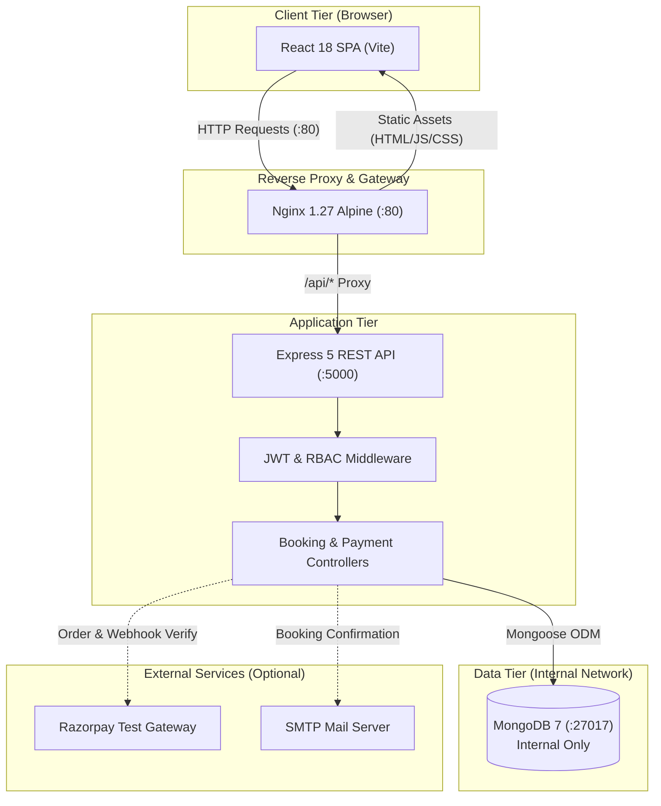
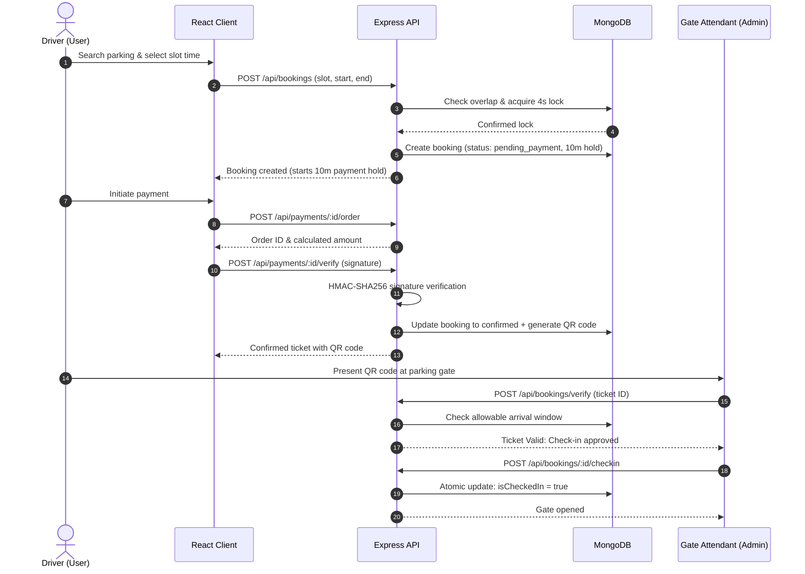

# ParkEase — Smart Parking Reservation & Management Platform

[](https://nodejs.org/)
[](https://expressjs.com/)
[](https://react.dev/)
[](https://www.mongodb.com/)
[](https://www.docker.com/)
[](https://nginx.org/)
[]()
[]()

> **Suggested GitHub Repository Description:**  
> *Full-stack smart parking reservation platform built with React, Node.js/Express, MongoDB, Docker & Nginx. Features atomic slot reservation, QR-code ticket verification, Razorpay test payments, and role-based admin analytics.*

---

## 📌 Overview

**ParkEase** is a production-ready, full-stack parking discovery, reservation, and facility management platform. It addresses urban parking friction by giving drivers real-time slot availability, instant reservations with conflict-free booking guarantees, secure test payment workflows, and digital QR-code gate tickets.

For facility managers and parking attendants, ParkEase provides real-time facility metrics, visual slot status management, an attendant QR-verification portal, and comprehensive revenue reporting.

---

## 🚀 Key Features

### 👤 Driver & Customer Features
- **Facility Discovery & Search:** Browse parking locations filtered by city, address, or facility name with live per-hour pricing.
- **Visual Slot Selection:** Interactive grid displaying slot availability, vehicle type (Car, Bike, EV), and status with 10-second polling.
- **Conflict-Free Reservation Engine:** Time-range booking algorithm enforcing half-open intervals `[start, end)` to prevent overlapping reservations.
- **Dual Payment Processing:** Supports Razorpay payment gateway in test mode with automated fallback to simulated instant payment.
- **Digital QR Gate Tickets:** Instant generation of cryptographic QR-code tickets upon booking confirmation.
- **Self-Service Gate Operations:** Check in and check out directly through the portal within allowable reservation windows.
- **User Reservation History:** Dedicated dashboard tracking pending, active, completed, and cancelled bookings with full receipt breakdowns.

### 🛡️ Administrator & Attendant Features
- **Executive Analytics Dashboard:** Real-time visibility into active users, registered facilities, total slot inventory, booking volume, and cumulative revenue.
- **Inventory Management:** Full CRUD operations for parking facilities and individual slots (enable, disable, rename, assign vehicle types).
- **Gate Attendant Verification Portal:** High-speed scanner interface to validate QR codes or manual booking IDs with gate status badges (*Ready for Check-In*, *Already Checked In*, *Expired*, *Cancelled*).
- **Audit Reports & Financials:** Complete booking audit trails with CSV export capabilities for accounting and revenue tracking.
- **Role-Based Access Control (RBAC):** Strict separation between user accounts and administrator privileges enforced at API routes and UI components.

---

## 🏗️ Architecture & Technology Stack

### Technology Stack
| Layer | Technologies |
|---|---|
| **Frontend** | React 18, Vite 6, Tailwind CSS v4, React Router 6, Axios, Lucide Icons |
| **Backend** | Node.js 20, Express 5, Mongoose 8, Helmet, CORS, express-rate-limit |
| **Database** | MongoDB 7 (persistent volume in Docker) |
| **Authentication** | JWT (JSON Web Tokens), bcryptjs password hashing |
| **Payments** | Razorpay Node.js SDK (test mode HMAC-SHA256 signature verification) |
| **Ticketing** | Node QRCode generator with cryptographic ticket IDs |
| **Deployment** | Docker, Docker Compose, Nginx 1.27 (Alpine) reverse proxy & static asset server |

### System Request Flow



### Core Request Workflow
1. **Frontend Request:** The browser interacts with the single public entry point on port `80` served by Nginx.
2. **Reverse Proxy:** Nginx serves static production bundles with gzip compression and transparently proxies `/api/*` calls to `http://server:5000/api/*`.
3. **Authentication Guard:** Express routes pass through `helmet` security headers, CORS origin checks, and rate limiters before JWT tokens are validated by `protect` and `adminOnly` middlewares.
4. **Data Isolation:** MongoDB is strictly isolated on the internal bridge network (`parkease-net`) and is never exposed to the host network in production.

---

## ⚙️ Workflows



---

## 📋 Prerequisites

Before running the application, ensure your environment meets the following requirements:

- **Node.js:** v18.0.0 or higher (v20 LTS recommended)
- **npm:** v9.0.0 or higher
- **MongoDB:** v7.0 or higher (required for local development mode)
- **Docker & Docker Compose:** Required only for containerized deployment (Docker Engine v24+ / Compose v2+)
- **OS:** Windows 10/11 (PowerShell), macOS, or Linux

---

## 🛠️ Step-by-Step Installation & Startup

### Option A: Local Development Setup (Recommended for Development)

Run frontend and backend independently with hot-reloading:

#### 1. Clone the repository
```bash
git clone https://github.com/krushna1845/parkease.git
cd parkease
```

#### 2. Start the Backend Server (Terminal 1)
```powershell
# Windows PowerShell
cd parkease\server
Copy-Item .env.example .env

# Linux / macOS
# cd parkease/server && cp .env.example .env

# Install backend dependencies
npm install

# Seed the database with sample areas, slots, and demo accounts
npm run seed

# Start backend in development mode (hot-reloading)
npm run dev
```
*Backend API will be live at: `http://localhost:5000`*

#### 3. Start the Frontend Client (Terminal 2)
```powershell
# Windows PowerShell
cd parkease\client
Copy-Item .env.example .env

# Linux / macOS
# cd parkease/client && cp .env.example .env

# Install frontend dependencies
npm install

# Start Vite dev server
npm run dev
```
*Frontend application will be live at: `http://localhost:5173`*

---

### Option B: Docker Compose Deployment (Production Setup)

Run the entire stack in isolated Docker containers with automated Nginx reverse proxying and internal networking:

```powershell
# Navigate to the inner parkease directory
cd parkease

# 1. Create Compose environment configuration
Copy-Item .env.example .env
# Linux / macOS: cp .env.example .env

# 2. Open .env and set a secure JWT_SECRET:
# Generate a secret: node -e "console.log(require('crypto').randomBytes(48).toString('hex'))"

# 3. Build container images
docker compose build

# 4. Start all services in detached mode
docker compose up -d

# 5. Populate initial demo data (first run only)
docker compose exec server node seed.js
```

*Open your browser and navigate to: `http://localhost` (Port 80)*

---

## 🔑 Demo Credentials

After running `npm run seed` (or `docker compose exec server node seed.js`), the following verified test accounts are available:

| Role | Email Address | Password | Permissions |
|---|---|---|---|
| **Administrator** | `admin@parkease.com` | `admin123` | Full access: metrics, inventory CRUD, ticket verification, audits |
| **Driver (User)** | `user@parkease.com` | `user123` | Standard access: search, reserve slots, test payments, view tickets |

> **Note on Email Notifications:** If SMTP credentials are left empty in `.env`, confirmation and cancellation emails are automatically logged to the server console.

---

## 🔐 Environment Variable Reference

| Variable Name | Required? | Scope | Safe Default / Placeholder | Description |
|---|---|---|---|---|
| `PORT` | Optional | Backend | `5000` | Port on which the Express REST API listens. |
| `MONGO_URI` | **Required** | Backend | `mongodb://127.0.0.1:27017/parkease` | MongoDB connection URI (`mongodb://mongo:27017/parkease` in Docker). |
| `JWT_SECRET` | **Required** | Backend / Docker | *No default* | Cryptographic secret for signing JWTs. App halts if missing. |
| `CLIENT_URL` | Optional | Backend | `http://localhost:5173` | Allowed CORS origin (`http://localhost:80` for Docker Compose). |
| `SERVER_PORT` | Optional | Compose | `5000` | Host port published for direct backend API access. |
| `CLIENT_PORT` | Optional | Compose | `80` | Host port published for the Nginx frontend proxy. |
| `VITE_API_URL` | Optional | Frontend | `http://localhost:5000/api` | API base URL for client requests (`/api` in Docker container). |
| `RAZORPAY_KEY_ID` | Optional | Backend | `""` | Razorpay test Key ID. Leave blank for simulated payment mode. |
| `RAZORPAY_KEY_SECRET` | Optional | Backend | `""` | Razorpay test Key Secret. Used for HMAC-SHA256 verification. |
| `RAZORPAY_WEBHOOK_SECRET`| Optional | Backend | `""` | Razorpay webhook signing secret. |
| `SMTP_HOST` | Optional | Backend | `""` | SMTP hostname. When empty, emails are logged to console. |
| `SMTP_PORT` | Optional | Backend | `587` | SMTP port (e.g., 587 for TLS). |
| `SMTP_USER` | Optional | Backend | `""` | SMTP username. |
| `SMTP_PASS` | Optional | Backend | `""` | SMTP password. |
| `NODE_ENV` | Optional | Backend | `development` | Runtime environment (`development`, `production`, `test`). |

---

## 🧪 Verified Test Results

All tests have been executed and verified in the local environment:

### 1. Backend E2E Test Suite (`npm test` in `parkease/server`)
```
================================================================
PARKEASE STEP 3: END-TO-END BOOKING ENGINE & PAYMENT TEST SUITE
================================================================

✓ Test 1 Passed: Valid booking creation created pending booking ID
✓ Test 2 Passed: Invalid and past time intervals rejected with 400
✓ Test 3 Passed: Booking for inactive slot rejected
✓ Test 4 Passed: Overlapping booking interval rejected with 409 Conflict
✓ Test 5 Passed: Two concurrent booking requests safely serialized (1 created, 1 rejected)
✓ Test 6 Passed: Half-open interval accepted back-to-back booking (existingEnd === newStart)
✓ Test 7 Passed: Server calculated authoritative amount (2h × 40 = Rs 80)
✓ Test 8 Passed: Unauthorized user access rejected with 403; admin access allowed with 200
✓ Test 9 Passed: Cancellation released hold and allowed new reservation
✓ Test 10 Passed: Unpaid hold older than 10 minutes released automatically
✓ Test 11 Passed: HMAC payment signature verified (invalid rejected 400, valid confirmed 200)
✓ Test 12 Passed: Duplicate webhook delivery handled idempotently without re-processing
✓ Test 13 Passed: Late payment after hold expiration reconciled and reinstated successfully
✓ Test 14 Passed: Fake/invalid QR ticket rejected with 404
✓ Test 15 Passed: First check-in succeeded; duplicate check-in rejected with 400

================================================================
ALL 15 TARGETED BOOKING & PAYMENT TESTS PASSED WITH 100% SUCCESS!
================================================================
```

### 2. Frontend Production Build (`npm run build` in `parkease/client`)
```
vite v6.4.3 building for production...
✓ 2036 modules transformed.
dist/index.html                   0.83 kB │ gzip:   0.48 kB
dist/assets/index-Cphyg6za.css   61.74 kB │ gzip:  10.45 kB
dist/assets/index-Dq4fBFx6.js   420.48 kB │ gzip: 114.13 kB
✓ built in 2.94s (0 errors, 0 warnings)
```

### 3. API Smoke Tests (Live Endpoint Verification)
```
✓ 1.  GET  /api/health                       → 200 OK
✓ 2.  POST /api/auth/login (admin)           → 200 OK (JWT issued)
✓ 3.  POST /api/auth/login (user)            → 200 OK (JWT issued)
✓ 4.  GET  /api/auth/me                      → 200 OK (Profile verified)
✓ 5.  GET  /api/areas                        → 200 OK (Array of facilities)
✓ 6.  GET  /api/slots/area/:areaId           → 200 OK (Slot inventory)
✓ 7.  GET  /api/admin/stats (admin token)    → 200 OK (Revenue & metrics)
✓ 8.  GET  /api/admin/bookings (admin token) → 200 OK (Audit trail)
✓ 9.  GET  /api/admin/stats (user token)     → 403 Forbidden (RBAC enforced)
✓ 10. GET  /api/bookings/my                  → 200 OK (User reservations)
✓ 11. POST /api/bookings/verify (fake ID)    → 404 Not Found (Safe rejection)

Result: 11 passed, 0 failed
```

### 4. Docker Validation
- **Compose Syntax:** Verified using `$env:JWT_SECRET="..."; docker compose config`
- **Container Images:** `parkease-server` and `parkease-client` built successfully with zero build errors.
- **Fail-Safe Mechanism:** `docker compose` and `server.js` halt immediately if `JWT_SECRET` is unset.

---

## 📖 API Documentation Reference

For the comprehensive API contract and interactive Postman examples, see [parkease/DOCS.md](parkease/DOCS.md). Key route summaries:

| Method | Endpoint | Access | Description |
|---|---|---|---|
| `GET` | `/api/health` | Public | Service health check |
| `POST` | `/api/auth/register` | Public (Rate-limited) | Register driver account |
| `POST` | `/api/auth/login` | Public (Rate-limited) | Authenticate & obtain JWT |
| `GET` | `/api/auth/me` | User | Get current profile |
| `GET` | `/api/areas` | Public | List parking areas |
| `GET` | `/api/slots/area/:areaId` | Public | List slots for an area |
| `POST` | `/api/bookings` | User | Create a slot reservation hold |
| `GET` | `/api/bookings/my` | User | List user's booking history |
| `GET` | `/api/bookings/:id` | User / Admin | Get booking receipt & payment |
| `POST` | `/api/bookings/verify` | User / Admin | Verify ticket QR or ID |
| `POST` | `/api/bookings/:id/checkin` | User / Admin | Check in vehicle at gate |
| `POST` | `/api/bookings/:id/checkout`| User / Admin | Check out vehicle |
| `PUT` | `/api/bookings/:id/cancel` | User / Admin | Cancel reservation & release hold |
| `POST` | `/api/payments/:id/order` | User | Generate Razorpay order ID |
| `POST` | `/api/payments/:id/verify` | User | Verify HMAC signature & issue QR |
| `POST` | `/api/payments/webhook` | Public | Idempotent Razorpay webhook |
| `GET` | `/api/admin/stats` | Admin Only | Operational metrics & revenue |
| `GET` | `/api/admin/bookings` | Admin Only | Global booking audit records |
| `GET` | `/api/admin/users` | Admin Only | User registry list |
| `DELETE`| `/api/admin/users/:id` | Admin Only | Remove user account |

---

## 🛑 Docker Management & Data Safety

### Stopping the Stack
To stop all containers while **preserving your database volume**:
```bash
docker compose down
```

### Resetting the Database
If you wish to wipe all database records and start completely fresh:
```bash
# WARNING: This deletes the mongo_data named volume
docker compose down -v
```

---

## 🔧 Troubleshooting Guide

| Issue | Likely Cause | Resolution |
|---|---|---|
| `MongoDB initial connection failed: connect ECONNREFUSED` | MongoDB is not running locally | Start MongoDB with `mongod` or run the database via Docker: `docker compose up -d mongo`. |
| `CRITICAL: JWT_SECRET environment variable is missing` | `.env` was not created or `JWT_SECRET` is blank | Copy `.env.example` to `.env` and set `JWT_SECRET=<random-key>`. |
| `403 Forbidden` on `/api/admin/*` | Logged in as regular user | Log out and log in with the administrator account (`admin@parkease.com`). |
| `502 Bad Gateway` on Nginx `/api/` | Backend container is starting or failing health check | Run `docker compose ps` to inspect service health; check logs via `docker compose logs server`. |
| `409 Conflict: Slot already reserved` | Another reservation exists for this interval | Choose an alternative time or another slot. |
| `bind: An attempt was made to access a socket in a way forbidden by its access permissions` (Port 80) | Windows reserved port 80 for system services (IIS / HTTP.sys) | In `parkease/.env`, change `CLIENT_PORT=80` to `CLIENT_PORT=3001` and `CLIENT_URL=http://localhost:3001`, then run `docker compose up -d`. |
| Razorpay checkout modal does not pop up | `RAZORPAY_KEY_ID` is unset | ParkEase automatically provides an instant "Pay & Confirm" fallback simulation mode. |

---

## 🔒 Security & Best Practices

1. **Environment Secrets:** Never commit `.env` or `.env.*` files. Root and nested `.gitignore` files are strictly configured to exclude secrets while allowing `.env.example` templates.
2. **Signature Verification:** All Razorpay payments use server-side HMAC-SHA256 signature calculation using `crypto.createHmac`. Client amounts are never trusted.
3. **Database Exposure:** In Docker Compose, MongoDB does not publish ports to the host (`expose: 27017` only), shielding it from public exposure.
4. **Least Privilege Container:** The production backend Docker container executes under a non-root `appuser`.
5. **Rate Limiting:** Authentication routes are protected with `express-rate-limit` (30 requests / 15 minutes) against brute-force attacks.

---

## 🖼️ Portfolio Screenshots & Demo

Place actual screenshots in [`docs/screenshots/`](docs/screenshots/) according to the guide below:

| View | Expected Path | Status |
|---|---|---|
| **Landing Hero** | `docs/screenshots/01-landing-hero.png` | *Placeholder — capture during local run* |
| **Parking Discovery** | `docs/screenshots/02-parking-discovery.png` | *Placeholder — capture during local run* |
| **Real-Time Slot Grid** | `docs/screenshots/03-slot-grid.png` | *Placeholder — capture during local run* |
| **Booking & QR Ticket**| `docs/screenshots/04-booking-ticket.png` | *Placeholder — capture during local run* |
| **Gate Verification** | `docs/screenshots/05-gate-verification.png` | *Placeholder — capture during local run* |
| **Admin Analytics** | `docs/screenshots/06-admin-analytics.png` | *Placeholder — capture during local run* |

> **Live Demo:** *Pending cloud staging deployment. Follow [Option A](#option-a-local-development-setup-recommended-for-development) or [Option B](#option-b-docker-compose-deployment-production-setup) to run ParkEase locally.*

---

## 📄 License

This repository is maintained for portfolio and educational demonstration purposes. If you plan to distribute or use this code commercially, please refer to the author or open an issue to establish licensing terms.
