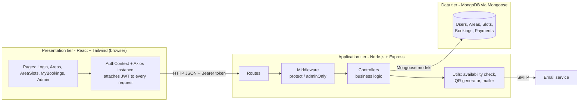
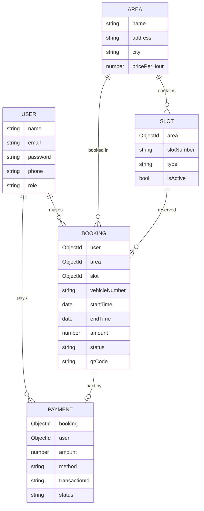
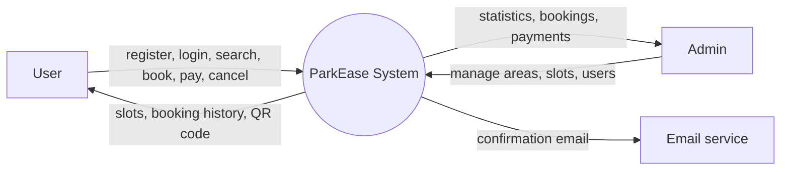
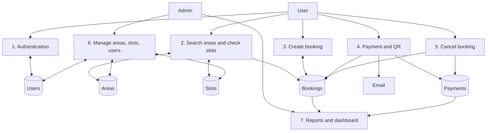
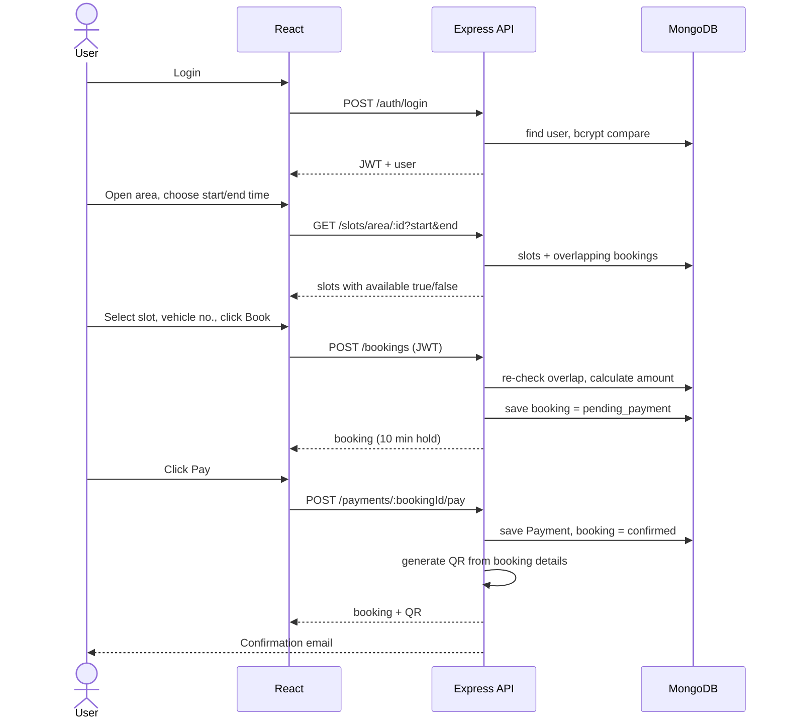
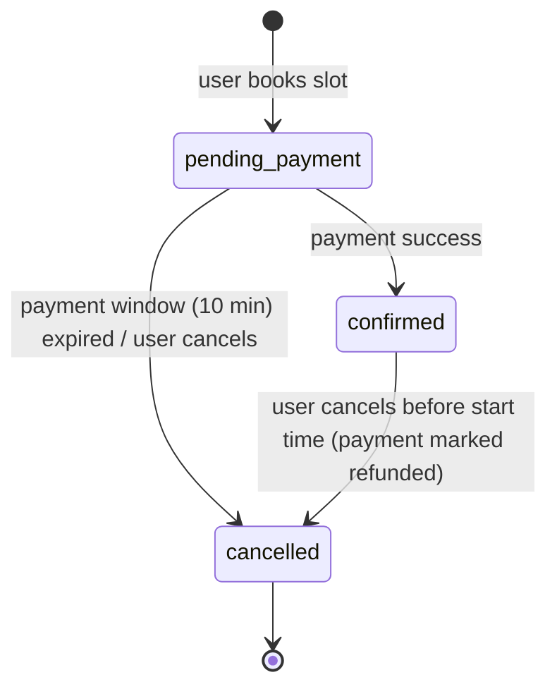

# ParkEase – Design Documentation

(Open in VS Code Markdown Preview or GitHub to see the diagrams.)

## 1. Architecture

**Style:** 3-tier client–server architecture, REST API, stateless authentication (JWT). The backend follows MVC: Routes -> Middleware -> Controllers -> Models.

| Layer | Responsibility |
|---|---|
| React pages | UI and form handling only, no business rules |
| Axios + AuthContext | Stores the JWT, sends it in `Authorization: Bearer`, keeps login state |
| Routes | Map URL + HTTP method to a controller and decide which middleware protects it |
| Middleware | `protect` verifies the JWT; `adminOnly` checks role |
| Controllers | All business rules (overlap check, price calculation, payment confirmation) |
| Models | Schema, validation, DB access |

**Why this design:** separation of concerns (UI / logic / data), so each part can be changed or tested independently. All rules are enforced on the server, because the client can never be trusted.

## 2. Database design (ER diagram)

- Relations are stored as ObjectId references (like foreign keys) and resolved with `populate()`.
- `Slot` has a unique compound index (area + slotNumber): no duplicate slot numbers in an area.
- `User.email` is unique. Passwords are stored only as bcrypt hashes.
- A booking has no `isAvailable` flag. Availability is **computed from bookings for a time range**, so one slot can be booked many times at different times.

## 3. Data flow diagrams

### Level 0 (context)

### Level 1 (main processes and data stores)

## 4. Workflow

### 4.1 Main booking workflow

### 4.2 Booking status lifecycle

### 4.3 Authentication and authorization flow
1. Register: password hashed with bcrypt, role forced to `user` (admin can only be created via seed/DB).
2. Login: server verifies the hash and returns a JWT (`{id}`, 7 days) signed with `JWT_SECRET`.
3. React saves the token in localStorage; the Axios interceptor adds it to every request.
4. `protect` middleware verifies the token and loads the user; `adminOnly` checks `role === 'admin'`.
5. React `Guard` component also hides pages, but this is only for UX. The real protection is the server middleware.

## 5. Key logic to explain

**Slot overlap (no double booking).** A slot is busy for a requested range when an existing booking satisfies:
`existing.start < requested.end AND existing.end > requested.start`
Only bookings that are `confirmed`, or `pending_payment` and younger than 10 minutes, block a slot (`utils/availability.js`). The same function is used to (a) colour the slot grid and (b) re-validate on `POST /bookings`.

**Price:** `ceil(hours) x area.pricePerHour`, calculated on the server.

**Pending hold:** an unpaid booking blocks the slot for 10 minutes; after that it is ignored automatically (no cron job needed, the expiry is part of the query).

**QR code:** generated after payment with the `qrcode` library. It encodes booking id, area, slot, vehicle and time as JSON and is stored as a base64 image in the booking.

**Dashboard:** MongoDB `countDocuments` and `aggregate` ($group, $lookup) for totals, revenue and bookings per area.

## 6. REST API

| Method | Endpoint | Access | Purpose |
|---|---|---|---|
| POST | /api/auth/register | public | Register user |
| POST | /api/auth/login | public | Login, returns JWT |
| GET | /api/auth/me | user | Current user |
| GET | /api/areas?q= | public | Search areas |
| GET | /api/areas/:id | public | Area details |
| POST/PUT/DELETE | /api/areas(/:id) | admin | Add / edit / delete area |
| GET | /api/slots/area/:areaId?start&end | public | Slots with availability |
| POST/PUT/DELETE | /api/slots(/:id) | admin | Add / edit / delete slot |
| POST | /api/bookings | user | Create booking (pending) |
| GET | /api/bookings/my | user | Booking history |
| PUT | /api/bookings/:id/cancel | user | Cancel booking |
| POST | /api/payments/:bookingId/pay | user | Pay, confirm, QR, email |
| GET | /api/admin/stats | admin | Dashboard statistics |
| GET | /api/admin/bookings, /payments, /users | admin | Lists |
| DELETE | /api/admin/users/:id | admin | Delete user |

## 7. Security measures
- Passwords hashed (bcrypt, 10 rounds), never returned by the API.
- JWT verification on protected routes; role-based access for admin routes.
- Role cannot be set during registration.
- Server-side validation (time range, slot active, overlap, ownership of booking).
- Regex input escaped in search to avoid regex injection.
- Users can only cancel or pay for their own bookings.

## 8. Honest limitations (say these before the examiner asks)
1. **Payment is simulated.** `paymentController` marks payment successful without a real gateway. Real version: Razorpay/Stripe order creation, then server-side signature verification / webhook before confirming.
2. **SMS is not implemented.** Email uses Nodemailer (console log if SMTP is not set). SMS would use Twilio or MSG91 in the same place `sendMail` is called.
3. **"Real-time" availability uses polling** (frontend refreshes every 10 s). True real-time would use Socket.io.
4. **Race condition:** two users booking the same slot at the exact same millisecond could both pass the overlap check. Production fix: MongoDB transactions or a unique lock document per slot and time bucket.
5. No refunds through a gateway (payment is just marked `refunded`), no rate limiting, no automated tests.

## 9. Likely viva questions

**Why MERN?** One language (JavaScript) end to end, JSON everywhere, MongoDB's flexible documents, and a large ecosystem.

**Why MongoDB and not SQL?** Data is document-shaped and the schema is simple. SQL would also work well here (the data is relational); the trade-off is that I do referential integrity through Mongoose refs instead of foreign keys.

**Why JWT instead of sessions?** Stateless: the server stores no session, so it scales easily and works well with a separate React frontend. Downside: a token cannot be revoked before expiry without extra work.

**How do you prevent double booking?** Time-range overlap query on every availability check and again at booking creation (section 5). Known limitation: race condition (section 8.4).

**What if the user never pays?** The booking holds the slot 10 minutes, then it is ignored by the availability query and rejected by the pay endpoint.

**How is admin secured?** Admin is created by seed only. Every admin route passes `protect` then `adminOnly`.

**Where is business logic placed and why?** In controllers on the server, so it cannot be bypassed by editing the frontend.

**Where do you store the token and is it safe?** localStorage. Simple, but exposed to XSS; httpOnly cookies are safer and would be my upgrade.

**How would you scale it?** Index frequently queried fields (booking slot + time), add caching, Socket.io for live updates, deploy the API behind a load balancer (stateless thanks to JWT).

## 10. Demo script (5 minutes)
1. Login as admin -> Dashboard -> add an area and a few slots.
2. Register a new user -> search the area -> pick a time range -> slots turn green/red.
3. Book a slot -> show status "pending payment" -> Pay -> QR appears, email log in server console.
4. Open a second browser as another user, same time range: that slot now shows "Booked".
5. Cancel the booking -> slot becomes free again; admin sees cancelled booking and refunded payment.
6. Admin dashboard: revenue and bookings per area.
