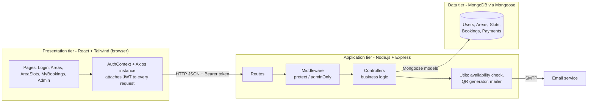
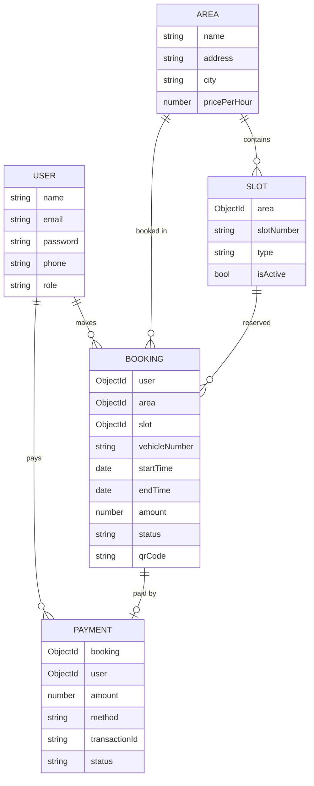
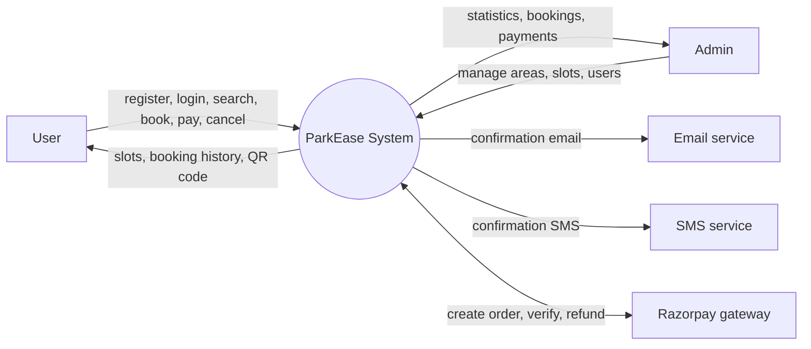
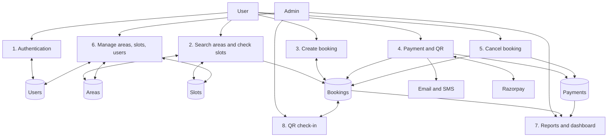
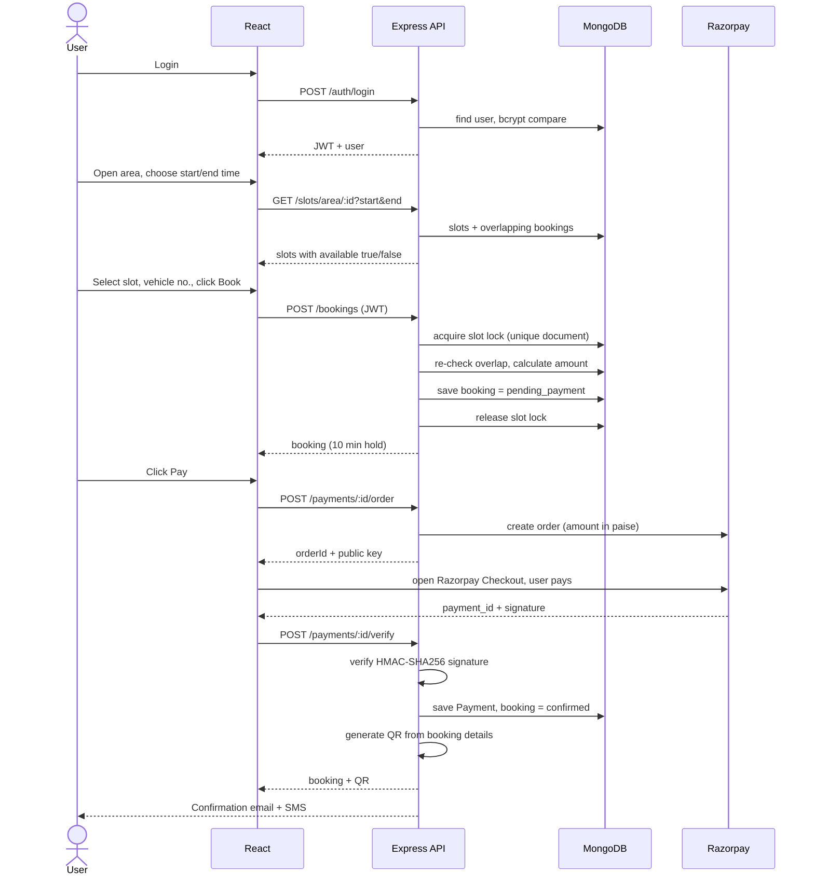
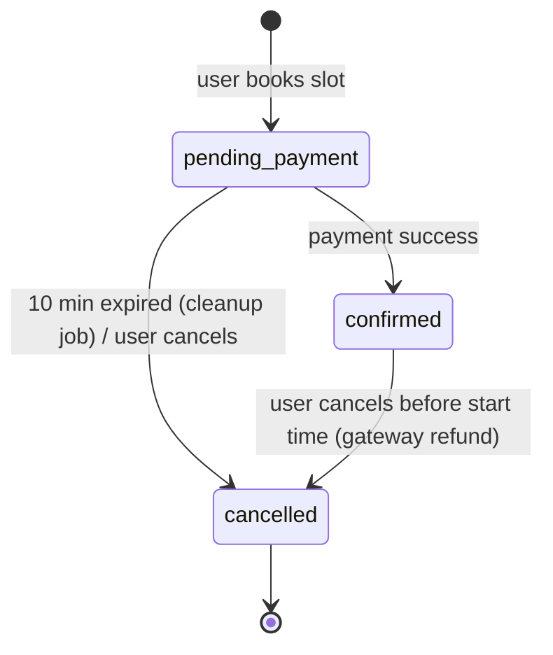

# ParkEase – Design Documentation

(Open in VS Code Markdown Preview or GitHub to see the diagrams.)

## 1. Architecture

**Style:** 3-tier client–server architecture, REST API, stateless authentication (JWT). The backend follows MVC: Routes -> Middleware -> Controllers -> Models.

| Layer | Responsibility |
|---|---|
| React pages | UI and form handling only, no business rules |
| Axios + AuthContext | Stores the JWT, sends it in `Authorization: Bearer`, keeps login state |
| Routes | Map URL + HTTP method to a controller and decide which middleware protects it |
| Middleware | `protect` verifies the JWT; `adminOnly` checks role |
| Controllers | All business rules (overlap check, price calculation, payment confirmation) |
| Models | Schema, validation, DB access |

**Why this design:** separation of concerns (UI / logic / data), so each part can be changed or tested independently. All rules are enforced on the server, because the client can never be trusted.

## 2. Database design (ER diagram)

- Relations are stored as ObjectId references (like foreign keys) and resolved with `populate()`.
- `Slot` has a unique compound index (area + slotNumber): no duplicate slot numbers in an area.
- `User.email` is unique. Passwords are stored only as bcrypt hashes.
- A booking has no `isAvailable` flag. Availability is **computed from bookings for a time range**, so one slot can be booked many times at different times.

- `SlotLock` is a temporary technical collection (not business data). It holds a lock document while a booking for that slot is being created (see section 5).
- `Booking.checkedInAt` records the QR check-in; `Booking.razorpayOrderId` and `Payment.razorpayPaymentId` link a booking to its gateway payment.

## 3. Data flow diagrams

### Level 0 (context)

### Level 1 (main processes and data stores)

## 4. Workflow

### 4.1 Main booking workflow

### 4.2 Booking status lifecycle

### 4.3 Authentication and authorization flow
1. Register: password hashed with bcrypt, role forced to `user` (admin can only be created via seed/DB).
2. Login: server verifies the hash and returns a JWT (`{id}`, 7 days) signed with `JWT_SECRET`.
3. React saves the token in localStorage; the Axios interceptor adds it to every request.
4. `protect` middleware verifies the token and loads the user; `adminOnly` checks `role === 'admin'`.
5. React `Guard` component also hides pages, but this is only for UX. The real protection is the server middleware.

## 5. Key logic to explain

**Slot overlap (no double booking).** A slot is busy for a requested range when an existing booking satisfies:
`existing.start < requested.end AND existing.end > requested.start`
Only bookings that are `confirmed`, or `pending_payment` and younger than 10 minutes, block a slot (`utils/availability.js`). The same function is used to (a) colour the slot grid and (b) re-validate on `POST /bookings`.

**Price:** `ceil(hours) x area.pricePerHour`, calculated on the server.

**Pending hold:** an unpaid booking blocks the slot for 10 minutes; after that it is ignored automatically (no cron job needed, the expiry is part of the query).

**QR code:** generated after payment with the `qrcode` library. It encodes booking id, area, slot, vehicle and time as JSON and is stored as a base64 image in the booking.

**Dashboard:** MongoDB `countDocuments` and `aggregate` ($group, $lookup) for totals, revenue and bookings per area.

**Razorpay payment (test mode).** Three steps: (1) `POST /payments/:id/order`: the server asks Razorpay to create an order for the booking amount (in paise) and stores the order id on the booking. (2) The browser opens Razorpay Checkout, the user pays, and Razorpay returns `payment_id` and `signature`. (3) `POST /payments/:id/verify`: the server recomputes `HMAC_SHA256(order_id|payment_id, secret)` and compares it with the signature. The booking is confirmed **only** if it matches and the order id belongs to this booking. The secret key never reaches the browser, so a user cannot fake a success. If no Razorpay keys are configured the app runs in **demo mode** (fake payment); demo payment is disabled once keys exist.

**Refund.** On cancelling a confirmed booking the server calls the Razorpay refund API first; the booking is cancelled only if the refund succeeds.

**Concurrency control (double-booking race).** Check-then-insert is not atomic, so two simultaneous requests could both see the slot as free. `POST /bookings` first inserts a `SlotLock` document with a unique index on `slot`. Only one insert can succeed; the other gets duplicate-key error 11000 and receives "try again" (HTTP 409). The lock is deleted in a `finally` block, and a TTL index removes it automatically if the server crashes. This works on a standalone MongoDB, unlike transactions, which need a replica set.

**QR check-in.** The QR holds the booking id. `POST /admin/verify` looks it up and returns one of: `valid` (first scan, marks `checkedInAt`), `already_checked_in`, `too_early` (more than 15 min before start), `expired`, `cancelled`, `unpaid`, `not_found`. So a QR cannot be reused or used for a cancelled booking.

**Auto-expiry.** `utils/cleanup.js` runs every minute and marks unpaid bookings older than 10 minutes as cancelled, so stored data matches what users see.

**SMS and email.** After confirmation and cancellation the server sends an email (Nodemailer) and an SMS (Twilio REST API). Both print to the console when not configured, so the flow can be demonstrated without accounts.

**Reports.** `GET /admin/reports/bookings|payments?from&to` builds a CSV on the server (cells starting with `= + - @` are escaped to prevent spreadsheet formula injection). The React app downloads it with the JWT as a blob.

## 6. REST API

| Method | Endpoint | Access | Purpose |
|---|---|---|---|
| POST | /api/auth/register | public | Register user |
| POST | /api/auth/login | public | Login, returns JWT |
| GET | /api/auth/me | user | Current user |
| GET | /api/areas?q= | public | Search areas |
| GET | /api/areas/:id | public | Area details |
| POST/PUT/DELETE | /api/areas(/:id) | admin | Add / edit / delete area |
| GET | /api/slots/area/:areaId?start&end | public | Slots with availability |
| POST/PUT/DELETE | /api/slots(/:id) | admin | Add / edit / delete slot |
| POST | /api/bookings | user | Create booking (pending) |
| GET | /api/bookings/my | user | Booking history |
| PUT | /api/bookings/:id/cancel | user | Cancel booking |
| POST | /api/payments/:bookingId/order | user | Create gateway order (or return demo mode) |
| POST | /api/payments/:bookingId/verify | user | Verify Razorpay signature, confirm, QR, email + SMS |
| POST | /api/payments/:bookingId/pay | user | Demo payment (only when no gateway keys) |
| GET | /api/admin/stats | admin | Dashboard statistics |
| GET | /api/admin/bookings, /payments, /users | admin | Lists |
| DELETE | /api/admin/users/:id | admin | Delete user |
| POST | /api/admin/verify | admin | Verify QR code / check-in |
| GET | /api/admin/reports/:type?from&to | admin | CSV report (bookings or payments) |

## 7. Security measures
- Passwords hashed (bcrypt, 10 rounds), never returned by the API.
- JWT verification on protected routes; role-based access for admin routes.
- Role cannot be set during registration.
- Server-side validation (time range, slot active, overlap, ownership of booking).
- Regex input escaped in search to avoid regex injection.
- Users can only cancel or pay for their own bookings.
- Payment is trusted only after HMAC signature verification on the server, and the order id must match the booking (a payment for one booking cannot confirm another).
- Demo payment endpoint is disabled when real gateway keys are set.
- CSV export escapes formula-injection characters.

## 8. Honest limitations (say these before the examiner asks)
1. **Razorpay runs in test mode** with test keys. Going live needs KYC, live keys and HTTPS. Also there is no webhook: if a user pays but closes the browser before `/verify` runs, the booking is not confirmed and expires. A production system adds a Razorpay webhook (`payment.captured`) to confirm in that case.
2. **SMS needs a Twilio account** (trial accounts only send to verified numbers); without one, SMS text is printed in the server console.
3. **"Real-time" availability uses polling** (frontend refreshes every 10 s). True real-time would use Socket.io.
4. **QR verification is by pasted text/booking id**, not a live camera scanner. A camera scanner (e.g. `html5-qrcode`) would be added on the admin page.
5. The slot lock prevents simultaneous double booking on one API server or several, because the lock lives in MongoDB. Its TTL cleanup only runs about once a minute, so a lock left behind by a crash can block that slot for up to about a minute.
6. No rate limiting, input-format validation libraries or automated tests yet.

## 9. Likely viva questions

**Why MERN?** One language (JavaScript) end to end, JSON everywhere, MongoDB's flexible documents, and a large ecosystem.

**Why MongoDB and not SQL?** Data is document-shaped and the schema is simple. SQL would also work well here (the data is relational); the trade-off is that I do referential integrity through Mongoose refs instead of foreign keys.

**Why JWT instead of sessions?** Stateless: the server stores no session, so it scales easily and works well with a separate React frontend. Downside: a token cannot be revoked before expiry without extra work.

**How do you prevent double booking?** Time-range overlap query on every availability check and again at booking creation (section 5). Concurrent requests are serialised per slot with a database lock (section 5).

**What if the user never pays?** The booking holds the slot 10 minutes, then it is ignored by the availability query and rejected by the pay endpoint.

**How is admin secured?** Admin is created by seed only. Every admin route passes `protect` then `adminOnly`.

**Where is business logic placed and why?** In controllers on the server, so it cannot be bypassed by editing the frontend.

**Where do you store the token and is it safe?** localStorage. Simple, but exposed to XSS; httpOnly cookies are safer and would be my upgrade.

**How would you scale it?** Index frequently queried fields (booking slot + time), add caching, Socket.io for live updates, deploy the API behind a load balancer (stateless thanks to JWT).

**How do you make sure a payment is genuine?** The browser never confirms anything itself. Razorpay signs `order_id|payment_id` with a secret only the server knows; the server recomputes the HMAC and compares. Order id is also matched to the booking.

**Why a lock collection and not a transaction?** MongoDB transactions need a replica set, which a standalone dev database doesn't have. A unique-index lock works everywhere and is easy to explain (mutual exclusion).

**What stops someone reusing a QR code?** `checkedInAt` is set on the first valid scan; later scans return "already checked in". Cancelled, unpaid and expired bookings are rejected.

## 10. Demo script (5 minutes)
1. Login as admin -> Dashboard -> add an area and a few slots.
2. Register a new user -> search the area -> pick a time range -> slots turn green/red.
3. Book a slot -> show status "pending payment" -> Pay (Razorpay test checkout, or demo mode) -> QR appears; email and SMS lines appear in the server console.
4. Open a second browser as another user, same time range: that slot now shows "Booked".
5. Cancel the booking -> slot becomes free again; admin sees cancelled booking and refunded payment.
6. Admin dashboard: revenue and bookings per area.
7. Admin -> Verify QR: paste the booking ID shown under the QR -> "VALID"; verify again -> "ALREADY CHECKED IN".
8. Admin -> Reports: download the bookings CSV and open it in Excel.
